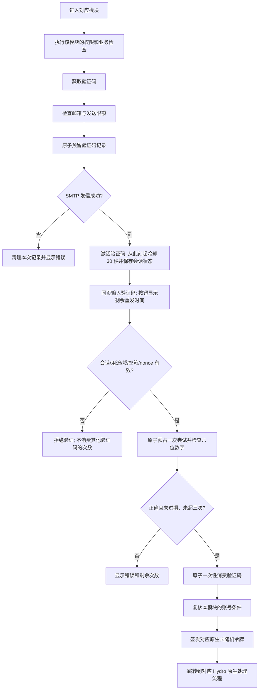

# 三种邮箱验证的流程约束

本文件描述当前三个模块应保持的行为，用于检查后续修改是否影响已有功能。验证码输入框始终允许输入；是否可以验证由按钮状态和服务端约束决定。

## 模块边界

| 项目 | 注册 `register` | 找回密码/用户名 `lostpass` | 更换邮箱 `changemail` |
| --- | --- | --- | --- |
| 用户入口 | `/register` | `/lostpass` | 安全设置 → 更换邮箱 |
| 发码接口 | 原生 `/register` 接入钩子 | 原生 `/lostpass` 接入钩子 | `/verification/changemail`；兼容原生 `change_mail` 请求 |
| 验证接口 | `/verification/register` | `/verification/lostpass` | `/verification/changemail` |
| 身份要求 | 原生注册权限，内置登录开启 | 不要求登录或注册权限 | 登录用户权限、原生 sudo 确认；首次/更换目标时复核密码 |
| 收件邮箱 | 尚未注册的邮箱 | 已绑定账号的邮箱 | 尚未占用的新邮箱 |
| 黑名单检查 | 发码时检查 | 沿用原生找回规则 | 发码时及签发原生令牌前检查 |
| 通过前复核 | 邮箱仍未占用 | 邮箱仍绑定发码时的 UID | 当前 UID、原邮箱、代登录身份仍匹配；新邮箱未占用 |
| 原生交接令牌 | `TYPE_REGISTRATION`，含邮箱和 mail 身份 | `TYPE_LOSTPASS`，仅含目标 UID | `TYPE_CHANGEMAIL`，含当前 UID 和新邮箱 |
| 后续处理 | 原生设置用户名/密码、创建账号及登录 | 原生展示用户名、更新密码 | 原生变更邮箱、返回安全设置 |
| `smtp.verify` 关闭 | 恢复原生免邮箱验证注册 | 仍需验证码 | 仍需验证码及身份确认 |

三种用途分别使用 `emailVerification_register`、`emailVerification_lostpass`、`emailVerification_changemail` 会话字段。数据库查询同时匹配用途、会话绑定、域和本次表单 nonce；更换邮箱再匹配账号身份。六位数字本身不是原生注册/找回/改绑令牌。

## 共用流程



共用规则：6 位数字，保留开头的 `0`；有效期 10 分钟；最多尝试 3 次；同一邮箱同用途从 SMTP 发送成功起至少冷却 30 秒；原子一次性消费；重发使同用途旧码失效。SMTP 发送期间，未激活记录持续占用发送锁，直至成功激活、失败清理或记录过期；不能因发信超过 30 秒而允许并发重发。SMTP 失败只清理本次记录，不能删除其他用途或后续重发的新记录。

验证码状态相互隔离，**原生 `send_mail` 发送配额仍共用**。每邮箱的原生 `send_mail` 窗口同步调整为 30 秒；默认每小时 30 封及其原生配置覆盖保持不变。因此使用另一个模块不会获得一套新的邮件发送限额。不同用途或不同账号也不能通过更换 IP 重置同一验证码的三次尝试预算。

## 界面状态

| 状态 | 验证码输入框 | 获取/重发按钮 | 继续验证 |
| --- | --- | --- | --- |
| 尚未发码 | 可输入 | 可点击，仍需邮箱及必要密码检查 | 禁用；后端也不接受无绑定验证码 |
| 正在请求 | 可输入 | 禁用，显示发送中 | 禁用，避免重复提交 |
| 已发码、倒计时中 | 可输入 | 禁用，显示实际剩余秒数 | 已有有效绑定且次数未耗尽时可点击 |
| 倒计时结束 | 可输入 | 可重新发送 | 同上 |
| 三次机会耗尽 | 可输入 | 冷却结束后可重新发送 | 禁用；后端拒绝消费 |
| 修改邮箱 | 可输入，清空旧输入值 | 为新目标获取验证码 | 旧邮箱的绑定不可提交给新目标 |
| 验证过期 | 可输入 | 可重新获取 | 后端拒绝；提交或刷新后更新界面状态 |

新发码成功得到确认时，前端从服务器给定的完整 30 秒冷却时长开始倒计时，不把 SMTP 等待时间扣进去。后端在 SMTP 成功激活时同步开始 30 秒冷却。刷新页面和验证错误响应使用后端实际剩余时间；后台停留或返回缓存页面按时间差更新，不能重新开始一个固定的 30 秒。发送成功后展示收件箱/垃圾邮件箱提示。发送失败保留可重试的表单，不能把失败当成已验证。

错误提示按字段就近展示：邮箱占用、邮箱不存在、格式与黑名单错误位于邮箱输入框下；密码错误位于密码框下；验证码错误位于验证码框下；发送频率限制位于验证码与发送按钮这一行下方，但不将验证码标记为无效。网络和通用异常放在“继续”按钮上方。错误文字为 13px 浅红色，紧贴对应输入框下方，保留适当间距；不添加背景、边框、内边距或圆角提示框。提交失败时定位到出错字段，编辑该字段后清除对应旧错误；验证码错误期间隐藏收件提示，剩余次数继续单独展示。后端通过未翻译的错误类型与字段输出 `errorField`，不可解析中文或其他显示文本来确定位置。四语提示与 `aria-describedby` / `aria-invalid` 一并维护。

更换邮箱的密码字段仅在需要建立新目标的密码复核时显示；密码复核成功后清空输入值。同一有效目标可复用本次复核；修改目标、验证过期、切换账号/代登录身份、原邮箱变化后都不得复用旧授权。sudo 过期时遵循原生确认流程。

## 后续修改必须保持的约束

1. 模板和脚本只负责展示与交互；密码复核、权限、有效期、尝试次数及邮箱归属必须由后端检查。
2. 修改更换邮箱的密码/sudo 逻辑，不能使注册或找回密码额外要求登录、当前密码或 sudo。
3. `smtp.verify` 只控制注册是否启用验证，不能关闭找回密码或更换邮箱的所有权验证。
4. 验证成功只签发本用途的原生令牌；不得在发送邮件阶段创建账号、重置密码或改变邮箱。
5. 注册与找回密码继续使用原生后续页面；更换邮箱继续由原生改绑 handler 更新账号。安全设置页面保留 `home_security` 页面名及其他功能。
6. 表单提交地址必须读取 `getAttribute('action')`，不得改回可能被具名控件覆盖的 `form.action`。不要引入名为 `action` 的表单控件。
7. JSON 同页请求和普通 HTML 表单回退都需保留；没有 JavaScript 时通过刷新更新等待状态。
8. 新增或修改界面/邮件/错误文本时，四种语言字典必须同时更新，并保留 `{0}` 等占位符。邮件继续使用原生语种选择及固定主题，不能把页面选项强制应用为另一套邮件语种规则。JSON 用户错误需先翻译再展示；未知内部错误使用已翻译的通用提示。

## 回归验证

修改共享模板、脚本、状态存储或任一模块的业务分支后，运行完整测试：

```sh
npm test
npm pack --dry-run --ignore-scripts --workspaces=false
```

测试覆盖各自的正常路径和失败路径，以及同一会话同时保留三种验证、六个方向的用途串用、配置开关隔离、跨模块发信失败隔离。涉及表单地址或导航时，还需用真实浏览器检查提交 URL 和原生跳转；jsdom 不能完整模拟浏览器的具名表单属性覆盖行为。

语言回归调用当前 Hydro 源码中的 `I18nService` 进行实际查找与回退，检查四语字典、三个页面、三种继承邮件、动态倒计时、JSON 错误以及区域语言代码。韩语请求即使带有中文备选语言，也不得因插件缺失翻译而出现中文。

线上检查使用只读页面及未登录权限检查，不通过修改用户的真实密码或邮箱来测试。测试通过代表上述约束经过验证，不能保证未来任意改动都不会引入新问题。
